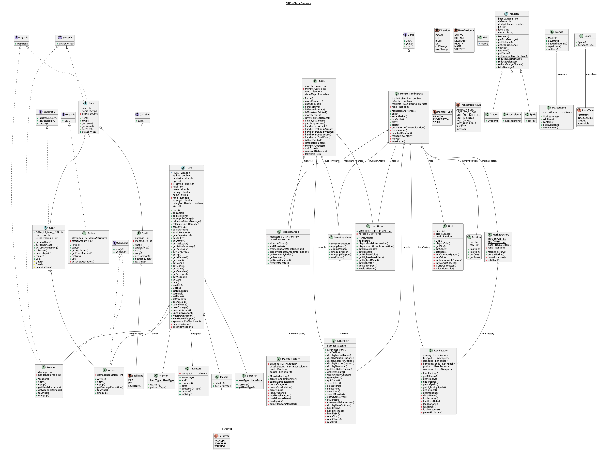

# CS611-Assignment 4
## Monsters and Heroes

Name: Tyler Smith  
Email: tylerw1@bu.edu  
BU ID: U25811409

## Interfaces

## Classes
### 1. MonstersandHeroes

**Implements:** `Game` (`start()`, `play()`, `end()`)
**Collaborates with:** `Controller`, `HeroFactory` (through `Controller`), `HeroGroup`, `MonsterGroup`, `Grid`, `Position`, `Battle`, `MarketFactory`, `ItemFactory`, `InventoryMenu`

MonstersandHeroes is the game itself. It owns the state that lasts across the whole run (the party, the map, the party's position, and the markets) and runs the main loop. It decides which screen or rule comes next. The rules themselves live in `Battle`, `Market`, and `Hero`, and all console input and output goes through `Controller`.

**Setup (`start()`)**
- Shows the welcome and instructions, asks for the party size and the heroes, then the world size, and builds the map. The party begins at the top-left tile.

**Main loop (`play()`)**
- Every pass draws the map, reads one command, and handles it:
   - `W`, `A`, `S`, `D`: move one tile. A move is rejected if it leaves the grid or enters an inaccessible tile.
   - `I`: show the party's information.
   - `V`: open the inventory menu for a hero, to equip gear, take it off, or use a potion without spending a battle turn.
   - `M`: enter the market, only if the party is on a market tile.
   - `Q`: quit.
- After a move onto a common tile (other than the start tile), the game rolls a dice with a fixed probability. On a bad roll, a battle starts at once.

**Battles (`startBattle()`)**
- A new group of monsters is created for each battle, scaled to the party. A `Battle` is made with the shared `Controller` and a callback that draws the map.
- The loop is: every living hero acts, then check whether the monsters are all defeated, then every monster acts, then check whether the heroes are all defeated, then end-of-round recovery.
- On a win: rewards go to heroes who did not faint, fainted heroes are revived at half health and mana, and heroes with enough experience level up.
- On a loss: the game-over screen is shown and the game ends.

**Markets (`enterMarket()`)**
- Each market tile gets its own market the first time it is entered, created by `MarketFactory`, and the same one is kept for every later visit. Heroes then enter one at a time, each with their own gold and backpack.

**Design notes**
- The main loop and the rules are separate classes. Replacing the console would only change `Controller`, and changing battle rules would only change `Battle`.
- One `Controller` (so one `Scanner`) is shared across the game, the battle, and the inventory menu.
- The factories are created once here, so data files are read once per game.

### 2. Battle

**Collaborates with:** `HeroGroup`, `MonsterGroup`, `Controller`, `InventoryMenu`, `Hero`, `Monster`, and the item classes (`Spell`, `Weapon`, `Armor`)

Battle runs one fight between the hero party and a group of monsters. It owns the round logic and the battle rules. It does not own the game loop, which stays in `MonstersandHeroes`. That class creates a `Battle`, repeats the round methods until one side is out, and then hands out the outcome.

**State**
- `monsters` and `heroes`: the two sides.
- `monsterLevel` and `monsterCount`: captured when the battle starts, because the monster group empties as monsters die and the rewards depend on the starting values.
- `showMap`: a `Runnable` supplied by the game, so a hero can view the map mid-battle without `Battle` knowing about the grid.

**Round structure**
- `heroesTurn()`: every living hero acts once. Each hero chooses attack, cast a spell, use a potion, equip a weapon, or equip armor. Showing statistics, showing the map, and quitting do not use the turn, and neither does a cancelled or failed action (no spells, not enough mana). The round stops early if the last monster is defeated.
- `monsterTurn()`: every monster attacks a random living hero. A hero may dodge, and armor reduces the damage taken.
- `endOfRound()`: living heroes regain 10% HP and 10% MP. Fainted heroes do not.

**Rules handled here**
- Monsters can dodge attacks and spells. Heroes dodge monster attacks through `Hero.attemptToDodge`.
- Attacks and spells go through `Monster.takeDamage`, so monster defense applies to both. Spells also apply their debuff (ice lowers damage, fire lowers defense, lightning lowers dodge).
- Mana is spent and a spell is used up even if the monster dodges it.
- Weapons wear down on every attack. Armor wears down only when a hit lands. Gear that breaks is unequipped automatically.
- A defeated monster is removed from the battle. A defeated hero is marked fainted but stays in the party.

**Outcome**
- `isMonstersFainted()` and `isHeroesFainted()` tell the game loop who won.
- On a win, `awardRewards()` gives gold (`monsterLevel * 100`) and XP (`monsterCount * 2`) to heroes who did not faint. Then `reviveFaintedHeroes()` brings fainted heroes back at half HP and mana with no reward.

**Design notes**
- Equipment and potion menus live in `InventoryMenu` so that battle and exploration share one implementation.
- Item behavior sits on the items (`Spell.cast`, `Potion.use`, `Equipable.equip`), so `Battle` controls the flow and does not need to know how each item type works.

### 3. Controller

**Collaborates with:** `HeroFactory`, `MonstersandHeroes`, `Battle`, `InventoryMenu`, `HeroGroup`, `MonsterGroup`, `Market`, and the hero and item classes it displays.

Controller is the game's only console interface. It prints menus and screens and reads and validates player input. It contains no game rules and does no file reading: the game loop, battle, market, and inventory classes decide what happens, `HeroFactory` supplies the heroes to choose from, and Controller only asks the player and returns the answer.

**Input handling**
- Every read goes through three private helpers built on `nextLine()`: `readChar()` (first character of a non-empty line, uppercased), `readChoice(validChars, errorMessage)` (re-prompts until the character is valid), and `readInt(min, max)` (re-prompts until the number is in range).
- No method uses `nextInt()`, so no leftover newline stays in the buffer, and empty or invalid input never crashes the game. The player is re-prompted instead.
- A single `Controller`, and so a single `Scanner` on standard input, is shared by the game, the battle, and the inventory menu.

**Screens and menus**
- **Setup:** a welcome screen that explains the controls, the map symbols, battles, and markets; party size; world size; and party selection. For each party slot the player picks a hero type (Warrior, Sorcerer, or Paladin) and then a hero from the list for that type. Heroes already chosen are not offered again, and the player can cancel back to the type menu.
- **Exploration:** the main command menu (move, hero info, market, inventory, quit) and the inventory menu for equipping gear, unequipping gear, and using potions.
- **Battle:** each hero's action menu, target selection, and the statistics view for heroes (level, HP, mana, equipped weapon and armor) and monsters (level, HP, damage, defense, dodge).
- **Market:** a buy, sell, repair, and leave loop for each hero in turn.
- **Game over:** a summary of the highest level, XP, gold, and mana reached.

**Reusable pieces**
- `selectItem(prompt, items)` and `selectItem(prompt, items, label)` show any list as a numbered menu with a Cancel option and return the chosen item, or `null` if cancelled. Hero selection, battle, inventory, and market menus all use them. The label version lets each list show what matters for it, such as sell or repair prices.
- `askYesNo(question)` is the shared yes/no prompt.

**Design notes**
- Menu methods return the chosen item or index instead of changing game state, so rules stay in the classes that own them, and the console could be replaced with another interface without touching the game logic.
- Hero data is loaded by `HeroFactory`, in the same way `ItemFactory` and `MonsterFactory` load items and monsters. The factory builds fresh heroes on every request, so the default values from the data files never change during play.

### 4. Monster (abstract)

**Subclasses:** `Dragon`, `Exoskeleton`, `Spirit`

Monster is the abstract base class for the monsters. It holds the state and behavior shared by all monsters, and it cannot be instantiated directly. Monsters are never created by hand: `MonsterFactory` loads their default stats from the data files and returns a fresh copy for each battle, so damage and spell debuffs never change the defaults.

**State**
- `name` and `level`, fixed at creation.
- `hp`: current health. The factory sets it to `level * 100`.
- `baseDamage`: used for the monster's attack damage.
- `defense`: reduces damage taken from attacks and spells.
- `dodgeChance`: the percent chance (for example 25 means 25%) to avoid a hero's attack or spell.

**Behavior**
- `takeDamage(rawDamage)`: reduces HP and returns the damage actually dealt. Defense works as a percentage reduction, `100 / (100 + defense)`, so higher defense always helps but a hit always does at least 1 damage.
- `reduceBaseDamage`, `reduceDefense`, `reduceDodgeChance`: lower a stat by a fraction. Ice, fire, and lightning spells use these, each lowering one stat by 10%.
- `getRandomMonsterType()`: picks one of the three monster types with equal probability, used when a battle's monsters are created.

**Design notes**
- Combat logic lives here, not in `Battle`. `Battle` only decides when to attack and calls `takeDamage`, so defense applies the same way to attacks and spells.
- Validation in the constructor rejects a missing name and negative stats.

### 5. Dragon, Exoskeleton, and Spirit

**Extend:** `Monster` (abstract)

These three classes are the three kinds of monsters the heroes can encounter. They are structurally identical: each has a constructor that passes its name, level, HP, base damage, defense, and dodge chance to `Monster`, and inherits all combat behavior from it.

- **Dragon:** favored attribute is base damage.
- **Exoskeleton:** favored attribute is defense.
- **Spirit:** favored attribute is dodge ability.

The favored attribute is expressed in the data files (`Dragons.txt`, `Exoskeletons.txt`, `Spirits.txt`), where each kind has higher values for its favored stat, so the classes do not need different code to behave differently. They exist so the monster kind is a real type in the program: `MonsterFactory` builds the correct subclass for each kind, and a kind-specific behavior can be added by overriding a method in that one class without touching `Monster`, `Battle`, or the other kinds.

### 6. MonsterGroup

**Collaborates with:** `Monster` (and its subclasses), `MonsterFactory`, `MonsterType`, `HeroGroup`, `Battle`

MonsterGroup is the collection of monsters the heroes face in one battle. It is the counterpart of `HeroGroup`: it stores the monsters, lets `Battle` look them up and remove defeated ones, and knows how to create a fresh group scaled to the party.

**State**
- `monsters`: the monsters currently in the fight. Defeated monsters are removed, so an empty group means the heroes have won.
- `monsterFactory`: the factory used to build new monsters. It is created once, so the data files are not re-read for every battle.

**Behavior**
- `createRandomMonsterGroup(HeroGroup)`: builds a new group for a battle. There is one monster per hero, and each monster is a random kind (dragon, exoskeleton, or spirit, with equal probability) at the level of the highest-level hero, as the specification describes. `MonsterFactory` falls back to the closest available level if the data files have no monster at that exact level.
- `addMonster(Monster)`: adds a monster, rejecting `null` and refusing to grow past the maximum group size (the same limit as the hero party, since there is one monster per hero).
- `removeMonster(Monster)`: removes a defeated monster. `Battle` calls this when a monster's HP reaches zero.
- `getMonsterByIndex(int)`: returns the monster at a position, so a hero can choose a target from a numbered list. An invalid index throws an exception.
- `getNumMonsters()`: the number of monsters still standing, which `Battle` uses to decide whether the heroes have won.
- `getMonsters()`: a read-only view of the list, so other classes can look at the monsters without changing the group.
- `displayMonsterGroupInformation()`: prints each monster's level, HP, base damage, defense, and dodge chance. This is the monster half of the in-battle information screen and the list shown when choosing a target.

**Design notes**
- Each battle gets a brand-new group of freshly built monsters, so damage and spell debuffs from one fight never carry over to the next, and the default values from the data files stay untouched.
- Choosing the type and level of monsters is the group's job, while reading the data files and handling level gaps is the factory's job. `Battle` only receives a ready group.

### 7. MonsterFactory

**Collaborates with:** `Monster`, `Dragon`, `Exoskeleton`, `Spirit`, `MonsterType`, `MonsterGroup`

MonsterFactory loads the default monster stats from the data files and builds monsters for battles. It keeps all file reading and level-matching rules in one place, so `MonsterGroup` and `Battle` never touch the files.

**Loading**
- On construction, the factory reads `Dragons.txt`, `Exoskeletons.txt`, and `Spirits.txt` once and keeps one list of default monsters per kind. Each file row gives a name, level, base damage, defense, and dodge chance. Monster HP is not in the files: it is calculated as `level * 100`, as the specification suggests.
- The first line of each file is a header and is skipped. A missing file stops the program with a clear error message that names the file.

**Creating monsters**
- `createRandomMonster(MonsterType type, int level)` returns a new monster of the requested kind, chosen at random from that kind's monsters at the requested level.
- If the data has no monster at that exact level, the factory uses the closest available level instead, so a party that outlevels the data files never crashes a battle. If two levels are equally close, one is picked at random. An invalid level (below 1) is rejected.
- The monster returned is always a new object built from the default's values, never the default itself. Damage taken and spell debuffs during a fight therefore never change the loaded defaults, and every battle starts from the original stats, as the specification requires for restarting the game.

**Design notes**
- The factory is created once and shared, so the files are read once per game instead of once per battle.
- The favored attribute of each kind (dragons hit harder, exoskeletons have more defense, spirits dodge more) comes from the data files, so adjusting balance means editing a text file and not the code.
- Each kind is built as its own subclass, so a kind-specific behavior can be added later by overriding a method in that one class.

### 8. Hero (abstract)

**Subclasses:** `Warrior`, `Sorcerer`, `Paladin`
**Collaborates with:** `Inventory`, `Weapon`, `Armor`, `Potion`, `Spell`, `Monster`

Hero is the abstract base class for a member of the player's party. It holds everything the specification says a hero has, and it owns the rules for how a hero equips gear, deals and takes damage, dodges, uses items, and levels up.

**State**
- `name`, `level`, `xp`, `hp`, `mana`, and `gold`.
- Three skills: `strength` (weapon damage), `dexterity` (spell damage), and `agility` (dodging).
- `backpack`: the hero's own `Inventory`. Heroes do not share gold or items.
- The equipped `weapon` and `armor`, plus whether a one-handed weapon is held in both hands.
- `isFainted`: a fainted hero stays in the party but cannot act for the rest of the battle.

**Equipment**
- A hero equips one weapon and one piece of armor. Equipping moves the item out of the backpack and returns the previous item to it, and only items the hero owns can be equipped. Broken gear cannot be equipped.
- A hero with no weapon fights with `FISTS`, a default weapon that is never in the backpack, never sold, and never wears out. Using it means attack code never needs a null check.
- Two-handed weapons always use both hands. A one-handed weapon can be held in both hands for a strength bonus (x1.5).
- `wearDownWeapon()` and `wearDownArmor()` use up one charge of the equipped item and unequip it automatically if it breaks. They return the broken item so `Battle` can report it.

**Combat**
- `calculateAttackDamage()`: `(strength + weapon damage) * 0.2`. The specification suggests 0.05, which made fights too long with the data file values.
- `calculateSpellDamage(spell)`: `spell damage + (dexterity / 10000) * spell damage`, as in the specification.
- `attemptToDodge()`: a chance of `agility * 0.005`, capped at 70%. The specification's `agility * 0.002` goes above 100% with the data file values.
- `takeDamage(rawDamage)`: subtracts the equipped armor's damage reduction, lowers HP (never below 0), and returns the damage actually taken.

**Items and money**
- `applyPotion(potion)` adds the potion's effect amount to each attribute it affects (health, mana, strength, dexterity, or agility).
- `spendMana`, `spendGold`, and `addGold` change the hero's resources. Spending more than the hero has is rejected.

**Progression**
- `xpNeededForNextLevel()` is `level * (level + 1) * 5`. Experience is never lost: it is a running total, and the formula is the total needed to reach the next level (10 for level 2, 30 for level 3, and so on).
- `levelUp()` raises the level, resets HP to `level * 100`, multiplies mana by 1.1, and raises every skill by 5%, or 10% for the hero type's favored skills.

**Display**
- `getOverview()` is the exploration screen: level, XP progress, HP, mana, gold, and all three skills.
- `getBattleSummary()` is the battle screen: level, HP, mana, fainted status, and the equipped weapon and armor.

**Design notes**
- Hero rules live on `Hero`, not in `Battle`, so the battle only decides when something happens.
- The abstract `getHeroType()` is how the subclasses identify themselves.

### 9. Warrior, Sorcerer, and Paladin

**Extend:** `Hero` (abstract)

These are the three hero types in the specification. Each has a constructor that passes its name, starting mana, strength, agility, dexterity, gold, and experience to `Hero`, and implements `getHeroType()` to return its own `HeroType`. All other behavior is inherited.

- **Warrior:** favored skills are strength and agility.
- **Sorcerer:** favored skills are dexterity and agility.
- **Paladin:** favored skills are strength and dexterity.

A favored skill is larger at the start of the game (the data files give each type higher starting values for its favored skills) and grows 10% per level instead of 5%, which is applied in `Hero.levelUp()` by checking the hero's type. Individual heroes, such as Gaerdal_Ironhand or Rillifane_Rallathil, are rows in `Warriors.txt`, `Sorcerers.txt`, and `Paladins.txt`, not classes.

### 10. HeroGroup

**Collaborates with:** `Hero`, `Battle`, `MonsterGroup`, `MonstersandHeroes`

HeroGroup is the player's party of one to three heroes. It stores the heroes and gives the rest of the game one place to ask questions about the whole party.

**State**
- `heroes`: the party members, in the order they were chosen.
- `MAX_HERO_GROUP_SIZE` (3): the party size limit, which `Controller` uses when asking for a party size and `MonsterGroup` uses for its own limit, since there is one monster per hero.

**Behavior**
- `addHero(hero)`: adds a hero, rejecting `null` and refusing to go over the size limit.
- `getHeroes()`: a read-only view of the party, so other classes can look at the heroes but not change the group's membership.
- `getHeroByIndex(index)` and `getNumHeroes()`: lookup for hero selection menus.
- `getHighestLevelHero()`: the level of the strongest hero. The monsters in a battle are created at this level.
- `getHighestXP()`, `getHighestGold()`, and `getHighestMana()`: used by the game-over summary.
- `levelUpHeroes()`: after a battle, levels up every hero who has enough experience, repeating if a hero earned several levels at once.
- `displayHeroGroupInformation()` and `displayBattleInformation()`: the exploration and battle information screens, built from each hero's `getOverview()` and `getBattleSummary()`.

**Design notes**
- Fainted heroes are not removed from the group. They are flagged on the hero, which is what allows them to be revived after a victory.

### 11. HeroFactory

**Collaborates with:** `Hero`, `Warrior`, `Sorcerer`, `Paladin`, `HeroType`, `Controller`

HeroFactory reads the default hero stats from the data files and builds heroes, in the same way `ItemFactory` and `MonsterFactory` do for items and monsters. It keeps all hero file reading out of the console class.

- On construction it reads `Warriors.txt`, `Sorcerers.txt`, and `Paladins.txt` once. Each row gives a name, mana, strength, agility, dexterity, starting gold, and starting experience, and underscores in names become spaces.
- `getAvailableHeroes(type, excludedNames)` returns new heroes of that type, leaving out names already in the party. `Controller` shows this list for the player to choose from.
- Every call builds new `Hero` objects from the stored values. The defaults are never handed out, so levelling up, buying, or taking damage never changes them, and each new game starts from the original values, as the specification requires.
- A missing data file stops the program with an error message that names the file.

### 12. Item (abstract)

**Subclasses:** `Gear` (which `Weapon` and `Armor` extend), `Potion`, `Spell`
**Implements:** `Buyable`, `Sellable`

Item is the base class for everything a hero can buy, sell, and carry. It holds the three things the specification says every item has: a name, a price, and a required level.

**State**
- `name`, `price`, and `level`, all fixed at creation.

**Behavior**
- `getPrice()` is the purchase price. `getSellPrice()` is half of it, as the specification requires.
- `copy()` is abstract. Each subclass returns a new object with the same stats and full uses. Markets and heroes always receive copies, so using or wearing an item never changes the defaults loaded from the data files.

**Design notes**
- Item types are data, not classes. A "Sword" or a "Healing Potion" is a row in a text file, not a subclass, so adding a new item means adding a line to a file.
- The market and the inventory only deal with `Item`, so they work with every item type, including ones added later.

### 13. Gear (abstract)

**Extends:** `Item` | **Subclasses:** `Weapon`, `Armor` | **Implements:** `Repairable`

Gear is an item that wears out. The specification says items have several uses and can be repaired at the market for half the purchase price. Weapons and armor share that behavior, so it is written once here.

- `maxUses` and `usesRemaining`: every piece starts with 10 uses (`DEFAULT_MAX_USES`), because the data files have no durability column.
- `use()` removes one use. `isBroken()` is true at zero.
- `needsRepair()`, `getRepairCost()`, and `repair()` come from `Repairable`. Repair costs half the price and restores full uses.
- `describeUses()` gives the "7/10 uses" or "BROKEN" text used in item descriptions.

### 14. Weapon

**Extends:** `Gear` | **Implements:** `Equipable`

A weapon is what a hero attacks with.

- `damage`: the amount added to the hero's strength in the attack formula.
- `handsRequired`: 1 or 2. Two-handed weapons are always held in both hands. A one-handed weapon can be held in both for a strength bonus, which `Hero` applies.
- `equip(hero)` and `unequip(hero)` delegate to the hero's equip methods. `unequip` only acts if the hero is holding this exact weapon.
- A weapon loses one use on every swing, hit or miss. A broken weapon is unequipped, the hero goes back to bare fists, and it stays in the backpack until repaired.

### 15. Armor

**Extends:** `Gear` | **Implements:** `Equipable`

Armor reduces the damage a hero takes from monsters.

- `damageReduction`: subtracted from each incoming hit by `Hero.takeDamage`.
- A hero wears one piece at a time. `equip(hero)` and `unequip(hero)` delegate to the hero's methods.
- Armor loses one use each time an attack lands on its wearer. Dodged attacks do not wear it. When it breaks it comes off, goes back to the backpack, and cannot be worn until repaired.

### 16. Potion

**Extends:** `Item` | **Implements:** `Useable`

A potion permanently raises one or more of a hero's attributes. It is single-use.

- `effectAmount`: how much to add.
- `attributes`: a set of `HeroAttribute` values (health, mana, strength, dexterity, agility, defense). Some potions affect several attributes, as in the data file (for example `Health/Mana/Strength/Agility`), and each one gets the full amount.
- `use(hero)` delegates to `Hero.applyPotion`. The code that called `use` removes the potion from the backpack afterwards, so one potion cannot be used twice.
- Using an enum instead of a text field means a typo in a data file fails when the game loads and not halfway through a battle.
- Known limitation: heroes have no defense stat, so the defense part of Ambrosia has no effect.

### 17. Spell

**Extends:** `Item` | **Implements:** `Castable`

A spell is a magic attack. It is single-use.

- `damage`: the base damage. `Hero.calculateSpellDamage` adds the dexterity bonus.
- `manaCost`: the hero needs at least this much mana, and it is deducted on casting.
- `type`: a `SpellType`. The type sets the extra effect, as in the specification:
   - **Ice** lowers the target's base damage.
   - **Fire** lowers the target's defense.
   - **Lightning** lowers the target's dodge chance.
     Each effect reduces that stat by 10%.
- `cast(hero, monster)` deals the damage through `Monster.takeDamage`, so defense applies to spells, and then applies the effect. The effect is written on the spell, so `Battle` does not need a `switch` on spell types.
- `Battle` handles the parts that depend on battle state: choosing a target, spending mana, removing the used spell from the backpack, and rolling the monster's dodge. Mana and the spell are used up even if the monster dodges.

### 18. ItemFactory

**Collaborates with:** `Weapon`, `Armor`, `Potion`, `Spell`, `SpellType`, `HeroAttribute`, `MarketFactory`

ItemFactory reads the default item data from the data files and keeps one list of items per kind. It is the only class that knows the item file formats.

- On construction it reads `Weaponry.txt`, `Armory.txt`, `Potions.txt`, `FireSpells.txt`, `IceSpells.txt`, and `LightningSpells.txt`, once. The first line of each file is a header and is skipped. A missing file stops the program with a message naming it.
- Underscores in names become spaces, so the menus show "Healing Potion" and not "Healing_Potion".
- Each spell file's `SpellType` is attached to its spells as they are loaded, so a spell knows its own type.
- The last column of the potions file is split on `/` into a set of `HeroAttribute` values.
- `getAllItems()` returns every item in one list. `MarketFactory` uses it to stock markets. Per-kind getters are also available.
- The factory's items are the defaults and are never given directly to a market or hero. Each market gets `copy()` of them, so uses, sales, and repairs never change the defaults. Every new game starts from the original values.

### 19. Market

**Collaborates with:** `MarketItems`, `Hero`, `Item`, `Repairable`, `TransactionResult`, `Controller`

A Market is one shop on the map. It holds a stock of items and enforces the rules for buying, selling, and repairing. Each market tile has its own market with its own stock, and the same market is used every time the party returns to that tile.

**State**
- `inventory`: a `MarketItems` object holding the items currently for sale.

**Behavior**
- `buyItem(hero, item)`: checks the rules from the specification in order: the item must be in stock, the hero's level must be at least the item's level, and the hero must have enough gold. On success it takes the gold, removes the item from the stock, and puts it in the hero's backpack.
- `sellItem(hero, item)`: the hero must own the item. The hero is paid half the item's price, the item leaves the backpack, and it is added to the market's stock, so another hero (or the same one later) can buy it.
- `repairItem(hero, item)`: the hero must own the item, it must be repairable (weapons and armor), it must actually need repair, and the hero must have the gold. Repair costs half the purchase price and restores full uses.
- Each method returns a `TransactionResult` (success, not in stock, not owned, level too low, not enough gold, not repairable, or already full). Each result carries a message. The market reports what happened and `Controller` decides how to show it, so the rules contain no printing.

**Design notes**
- Heroes shop one at a time. Each has their own gold and backpack and shares nothing with the rest of the party.
- Equipped gear is not in the backpack, so it has to be unequipped before it can be sold or repaired.
- Items are copies of the defaults, so selling or repairing something never changes the loaded data.

### 20. MarketItems

**Used by:** `Market`

MarketItems is the stock list of one market. It wraps a list of items and exposes only the operations a market needs.

- `addItem(item)` and `removeItem(item)` change the stock. `contains(item)` checks if an item is in stock.
- `getInventory()` returns a read-only view of the list, so the menus can display the stock but cannot change it without going through the market's rules.

Keeping the stock in its own class means the market's buy, sell, and repair rules do not depend on how the stock is stored, and the storage could change without changing them.

### 21. MarketFactory

**Collaborates with:** `ItemFactory`, `Market`, `Item`

MarketFactory creates the markets and decides what each one sells. Its job is to make markets differ from each other, as the specification requires.

- Each new market gets 3 or 4 items, chosen at random.
- Items are dealt from a shuffled pool built from every item in the catalogue (`ItemFactory.getAllItems()`). An item is not repeated in a second market until the whole catalogue has been handed out once. Then the pool is reshuffled and dealing starts over. With more markets than items, repeats cannot be avoided, and this is the closest possible reading of "each market has different items".
- No market ever contains two items with the same name.
- Every item placed in a market is a `copy()` of the default, so purchases, sales, and repairs never change the defaults loaded from the data files.

**When markets are created**
- `MonstersandHeroes` creates a market the first time the party enters a given tile and keeps it in a map keyed by position. Stock therefore stays the same between visits, and anything a hero sold is still there. Markets on tiles the party never visits are never created and do not use up any of the pool.

**Design notes**
- `Market` knows nothing about data files or randomness. All of that is in the factory, and `Market` only holds items and applies the rules.

### 22. Space

**Used by:** `Grid`

A `Space` is one tile of the world. It has a `SpaceType`, which is one of three kinds from the specification:

- `COMMON`: heroes can enter, and a battle may start.
- `MARKET`: heroes can enter and use the market.
- `INACCESSIBLE`: heroes cannot enter.

`SpaceType` also knows whether its kind can be entered (`isAccessible()`), so movement code asks the type instead of comparing against specific tile kinds. Because the tile kind is an enum and not a class per kind, adding a new tile kind means adding one enum value and the rules that go with it.

### 23. Position

**Used by:** `Grid`, `MonstersandHeroes`

Position is an immutable row and column pair, with `getRow()` and `getCol()`. It exists so that the party's location, a map lookup, and a move destination are all passed around as one value and not as two loose integers. `Direction` (up, down, left, right) holds the row and column change for each move, so `MonstersandHeroes.move` adds a direction to a position and does not need a `switch` on the key pressed.

### 24. Grid

**Collaborates with:** `Space`, `SpaceType`, `Position`, `MonstersandHeroes`

Grid is the world map: a square board of spaces, with a size the player picks between 6 and 10.

**Generation**
- When created, the grid places inaccessible, market, and common spaces at random, using the proportions suggested in the specification (about 20% inaccessible, 30% market, and the rest common).
- It checks that the map is usable: the starting tile is accessible, and `isGridConnected()` confirms the accessible tiles can all be reached from it, so a random layout can never trap the party or hide a market behind walls.

**Behavior**
- `getSpace(position)` and `setSpace(...)` read and write tiles, and `getDim()` returns the size, so `MonstersandHeroes` can check that a move stays on the board.
- `displayGrid(currentPosition)` draws the map: `[P]` for the party's location, `[M]` for a market, `[X]` for an inaccessible tile, and `[ ]` for a common tile.

**Design notes**
- The grid only knows what is on each tile. It does not know about heroes, battles, or markets' stock, which keeps the map separate from the game rules.

### 25. Inventory

**Used by:** `Hero`, `Market`, `Controller`, `InventoryMenu`
**Holds:** `Item` objects

Inventory is a hero's backpack. Every hero has their own, and heroes never share items, as the specification requires. It stores items of every type in one list and does not limit how many a hero can carry, since the specification says no maximum is needed.

**Behavior**
- `add(item)`, `remove(item)`, and `contains(item)` work on any `Item`, so weapons, armor, potions, and spells all use the same methods. Adding or removing `null` does nothing.
- `getItemsOfType(Class)` returns the items of one kind, for example all weapons or all potions. Each menu uses it to list only the items it needs, with its own numbering. "Equip a weapon" shows weapons, "use a potion" shows potions, and so on.
- `get(index)` returns the item at a position.
- `toString()` prints the whole backpack as a numbered list, using each item's own description, or "Inventory is empty."

**Design notes**
- Equipped gear is not kept in the backpack. Equipping moves the item out and unequipping moves it back, so an item is never both worn and sellable. This is why gear has to be unequipped before it can be sold or repaired.
- Because the inventory works with `Item` and not with specific item classes, a new item type needs no changes here.

### 26. InventoryMenu

**Collaborates with:** `Controller`, `Hero`, `Inventory`, `Weapon`, `Armor`, `Potion`
**Used by:** `Battle`, `MonstersandHeroes`

InventoryMenu holds the equip, unequip, and potion flows for a hero. It exists so the exploration screen and the battle screen share one implementation, with nothing copied between `Battle` and `MonstersandHeroes`.

**Behavior**
- `equipWeapon(hero)`: lists the hero's weapons and equips the chosen one. A one-handed weapon prompts for whether to hold it with both hands, and a two-handed weapon always uses both. Broken weapons cannot be equipped, and the player is told to repair them at a market.
- `equipArmor(hero)`: lists the hero's armor and equips the chosen piece. Broken armor is refused in the same way.
- `usePotion(hero)`: lists the hero's potions, applies the chosen one, and removes it from the backpack, since potions are single-use.
- `unequipWeapon(hero)` and `unequipArmor(hero)`: take the item off and return it to the backpack. They are used from the exploration menu, which is how a player gets gear into the backpack to sell or repair it.

**Turn handling**
- The equip and potion methods return `true` if something actually happened and `false` if the player cancelled or could not act (no items, broken gear). In battle, `Battle` uses this to decide whether the hero's turn was used. Equipping or using a potion in battle costs the turn, and backing out of a menu does not.
- Outside battle the return value is ignored, so the same actions are free, as the specification says.

**Design notes**
- The menu holds no item rules. It asks the item to act through its interface: `Equipable.equip` and `unequip` for gear, and `Useable.use` for potions. It only handles choosing and cancelling, through the shared `Controller`.
- Menus for spells stay in `Battle`, because casting needs a target monster and the state of the fight.

### 27. Main

**Collaborates with:** `MonstersandHeroes`

Main is the program's entry point. It creates a `MonstersandHeroes` game with a chosen battle probability (the chance that stepping onto a common tile starts a battle) and calls `play()`. It holds no game logic. Everything else is in `MonstersandHeroes` and the classes it uses.

**Changing the difficulty**
- The battle probability is a value between 0.0 and 1.0, passed to the game's constructor, which rejects anything outside that range. A higher value means more frequent battles. To change it, edit that one value in `Main`, with no change needed anywhere else.

## Interfaces

The project uses small interfaces so that each part of the game depends on what an object can do and not on its concrete class. Menus and rules ask for an interface type, so a new item or game type works with the existing code without changing it.

### 1. Game

**Implemented by:** `MonstersandHeroes`

| Method | Purpose |
|---|---|
| `start()` | Set up a new game: welcome screen, party selection, and map creation. |
| `play()` | Run the main loop until the game ends. |
| `end()` | Shut the game down. |

Game describes the life cycle of any game run by `Main`. The monsters-and-heroes game is the only implementation, but the interface means a different game could be run through the same entry point, and the game's own details stay out of `Main`.

### 2. Buyable

**Implemented by:** every item, through `Item`

| Method | Purpose |
|---|---|
| `getPrice()` | The price a hero pays at a market. |

### 3. Sellable

**Implemented by:** every item, through `Item`

| Method | Purpose |
|---|---|
| `getSellPrice()` | The gold a hero receives for selling the item: half the purchase price, as the specification requires. |

`Buyable` and `Sellable` are separate so that the two market operations depend only on what they need. All four item types are currently both, but an item that can be bought and not sold (or the reverse), such as a quest item, could be added by implementing just one of them.

### 4. Equipable

**Implemented by:** `Weapon`, `Armor`

| Method | Purpose |
|---|---|
| `equip(hero)` | Put the item on the hero, returning anything it replaces to the backpack. |
| `unequip(hero)` | Take the item off the hero and return it to the backpack. |

The inventory menu equips and unequips through this interface, so it handles weapons and armor the same way and needs no changes for a new kind of gear. `unequip` does nothing if the hero is not wearing that exact item.

### 5. Useable

**Implemented by:** `Potion`

| Method | Purpose |
|---|---|
| `use(hero)` | Apply the item's effect to the hero. |

The caller removes the item from the backpack afterwards, since potions are single-use. Anything consumable that acts only on the hero, such as a revival scroll or food, could implement it.

### 6. Castable

**Implemented by:** `Spell`

| Method | Purpose |
|---|---|
| `cast(hero, monster)` | Resolve the spell against a target monster. |

`Castable` is separate from `Useable` because the two work differently: a potion acts only on the hero, while a spell needs a target and mana. Keeping them apart means no method has a parameter it ignores. "Use a potion" lists the hero's `Useable` items and "Cast a spell" lists their `Castable` items, so each battle menu filters by its own interface.

### 7. Repairable

**Implemented by:** `Gear` (so `Weapon` and `Armor`)

| Method | Purpose |
|---|---|
| `needsRepair()` | True if the item has lost any uses. |
| `getRepairCost()` | The cost to repair: half the purchase price. |
| `repair()` | Restore the item to full uses. |

The market's repair option works on `Repairable`, not on weapons and armor specifically. Potions and spells are single-use, so they are not repairable.

### Which classes implement which interface

| Class | Interfaces |
|---|---|
| `Item` | `Buyable`, `Sellable` |
| `Gear` | `Repairable` (and `Buyable`, `Sellable` through `Item`) |
| `Weapon`, `Armor` | `Equipable` |
| `Potion` | `Useable` |
| `Spell` | `Castable` |
| `MonstersandHeroes` | `Game` |

## Enums

The project uses enums for fixed sets of choices, where the alternative would be strings or integers that could be mistyped. An enum is use where a "type" only changes data and not behavior such as spell kinds, monster kinds, potion attributes, an enum value is used instead of a subclass.

### 1. Direction

**Values:** `UP`, `DOWN`, `LEFT`, `RIGHT`
**Used by:** `MonstersandHeroes`

Each direction stores its row change and column change (`getRowChange()`, `getColChange()`). Movement adds the direction's change to the party's position, so there is no `switch` on the key pressed and no repeated arithmetic. The key-to-direction mapping is the only place that knows about `W`, `A`, `S`, `D`.

### 2. SpaceType

**Values:** `COMMON`, `MARKET`, `INACCESSIBLE`
**Used by:** `Space`, `Grid`, `MonstersandHeroes`

The three kinds of tile from the specification. `isAccessible()` says whether heroes can enter, so movement code does not compare against specific kinds. Battles can start on `COMMON` tiles, and the market can only be entered on a `MARKET` tile.

### 3. HeroType

**Values:** `WARRIOR`, `SORCERER`, `PALADIN`
**Used by:** `Hero` and its subclasses, `HeroFactory`, `Controller`

Identifies which kind of hero a hero is. It decides which skills are favored when a hero levels up (warriors: strength and agility, sorcerers: dexterity and agility, paladins: strength and dexterity), and it is how `HeroFactory` picks the data file and the class to build.

### 4. HeroAttribute

**Values:** `HEALTH`, `MANA`, `STRENGTH`, `DEXTERITY`, `AGILITY`, `DEFENSE`
**Used by:** `Potion`, `ItemFactory`, `Hero`

The attributes a potion can raise. A potion holds a set of these, because some potions raise several at once. `ItemFactory` converts the text in the potions file into these values when it loads, so a misspelled attribute fails at startup. `Hero.applyPotion` switches on the value to decide which stat to raise. `DEFENSE` is included because one potion in the data lists it, but heroes have no defense stat, so it currently has no effect.

### 5. MonsterType

**Values:** `DRAGON`, `EXOSKELETON`, `SPIRIT`
**Used by:** `Monster`, `MonsterFactory`, `MonsterGroup`

The three kinds of monster. Battles pick a type at random with equal probability and ask `MonsterFactory` for a monster of that type and level.

### 6. SpellType

**Values:** `FIRE`, `ICE`, `LIGHTNING`
**Used by:** `Spell`, `ItemFactory`

The three kinds of spell, each with its own extra effect, as in the specification:

| Type | Effect on the target monster |
|---|---|
| `ICE` | Lowers base damage by 10% |
| `FIRE` | Lowers defense by 10% |
| `LIGHTNING` | Lowers dodge chance by 10% |

`ItemFactory` sets the type of each spell as it loads the spell files, and `Spell.applyEffect` uses it. Spell kinds differ only in which stat they change, so they are an enum and not three subclasses.

### 7. TransactionResult

**Values:** `SUCCESS`, `NOT_IN_STOCK`, `NOT_OWNED`, `LEVEL_TOO_LOW`, `NOT_ENOUGH_GOLD`, `NOT_REPAIRABLE`, `ALREADY_FULL`
**Used by:** `Market`, `Controller`

The outcome of a buy, sell, or repair. Each value carries a message for the player (`getMessage()`). `Market` applies the rules and returns a result, and `Controller` prints the message. The rules therefore never print anything, and the wording of the messages is in one place.

## How to compile and run
1. Navigate to the directory containing the .java files after unzipping the project
2. Compile all Java source files into the bin directory:
   javac *.java -d bin
3. Run the program:
   java -cp ./bin Main

## Notes
### Game balance

The write-up says its example formulas are not guaranteed to be balanced and may be changed. With the values in the provided data files they were not playable as written, so several were adjusted from the write-up.

- hero attack damage
- hero dodge chance
- damage dealt by monsters
- how monster defense reduces damage
- how armor reduces damage
- the attack used when a hero has no weapon
- the strength bonus for holding a one-handed weapon in both hands

All of these are plain constants in the code and are easy to change. They would benefit from further playtesting and tuning, particularly the monster damage, hero damage, defense and armor reduction, and dodge probabilities, to make fights fairer.

### Other rule decisions

- Mana is spent and the spell is used up even if the monster dodges it.
- Heroes who level up are restored to full HP.
- Experience is a running total and is never subtracted, so each level needs a larger total than the last.
- If the data files have no monster at the party's level, the closest available level is used, so battles never crash for a high-level party.
- Weapons and armor have a limited number of uses and can be repaired at a market for half the purchase price. Potions and spells are single-use.
- Fainted heroes stay in the party and are revived at half HP and mana after a win, with no gold or XP for that battle.
- Heroes have no defense stat.
- Monsters choose a random living hero as their target.
- Equipped gear has to be unequipped before it can be sold or repaired.

### Design highlights

- **Data, not subclasses, for items.** Weapons, armor, potions, and spells are single classes whose types are rows in text files and enum values, so adding an item means adding a line to a file.
- **Shared wear-and-repair code.** `Gear` holds durability once for weapons and armor, with a `Repairable` interface for the market.
- **Behavior lives on the objects.** `Spell.cast`, `Potion.use`, and `Equipable.equip` and `unequip` keep item rules with the item, so `Battle` and the menus never `switch` on item types.
- **Factories and fresh copies.** `HeroFactory`, `MonsterFactory`, `ItemFactory`, and `MarketFactory` own all file reading and stocking. Everything handed to the game is a new copy, so nothing that happens during play changes the loaded defaults, and a new game starts from the original values.
- **Unique markets.** Markets are stocked from a shuffled pool, so no two markets share items until the whole catalogue has been used. Each market is created the first time it is visited and then kept.
- **Separation of concerns.** `Controller` is the only class that reads or prints for menus. `Market` returns a `TransactionResult` and never prints. `Battle` handles round rules, and `MonstersandHeroes` owns the game loop and world state.
- **One shared inventory menu.** `InventoryMenu` serves both exploration and battle, so equipping and potion logic is not duplicated.
- **Robust input.** Every read goes through helper methods that re-prompt on empty or invalid input, so bad input cannot crash the game. Most menus have a Cancel option, and cancelling does not use up a hero's turn.
- **Playable beyond the minimum.** The map is available in battle, and the world generator checks that the map is connected, so a random layout cannot trap the party.

## Input/Output Example
## Example Run

This is an excerpt of a session with one hero. Lines beginning with `>` are typed by the player. Long screens are shortened where marked with `[...]`. The map and command menu are shown before every command, but they are only repeated here where the map changes.

```text
==============================================
          LEGENDS: MONSTERS AND HEROES
==============================================
[... welcome screen and instructions ...]

How many heroes would you like to play with?
Please enter a number between 1 and 3:
> 1

Select a hero type:
W - Warrior
S - Sorcerer
P - Paladin
> W

========== WARRIOR OPTIONS ==========
1. Gaerdal Ironhand | Mana: 100 | Strength: 700 | Agility: 500 | Dexterity: 600 | Starting Gold: 1354 | Starting XP: 7
2. Muamman Duathall | Mana: 300 | Strength: 900 | Agility: 500 | Dexterity: 750 | Starting Gold: 2546 | Starting XP: 6
0. Cancel
> 1

Please choose a world size between 6 and 10:
> 6

[P][ ][X][ ][ ][ ]
[M][ ][ ][ ][X][ ]
[ ][X][ ][M][ ][ ]
[ ][ ][ ][ ][ ][X]
[X][ ][ ][ ][ ][ ]
[ ][ ][M][ ][ ][ ]

Enter a command:
  W - Move up
  A - Move left
  S - Move down
  D - Move right
  I - Show hero information
  M - Enter market
  V - Manage inventory
  Q - Quit game

Your choice:
> D
You moved successfully!
You've encountered monsters starting a battle

========== MONSTERS INFORMATION ==========

Monster 1: Natsunoshou
Level: 1
HP: 100
Base Damage: 100
Defense: 200
Dodge Chance: 10.0
---------------------------------------

========== HEROES TURN ==========
Enter a command:
  A - Attack, using Gaerdal Ironhand's equipped weapon
  S - Cast a spell from Gaerdal Ironhand's inventory
  P - Use a potion from Gaerdal Ironhand's inventory
  W - Equip a weapon
  E - Equip a piece of armor
  I - Show statistics
  M - Show the map
  Q - Quit the game
> A
[... monster list shown ...]
Select your desired target monster (1 to 1):
> 1
Gaerdal Ironhand attacked Natsunoshou for 51 damage!
Gaerdal Ironhand dodged Natsunoshou's attack!

========== HEROES TURN ==========
[... command menu ...]
> I
Would you like to see monster or hero statistics?
Enter 'M' for Monster or 'H' for Hero Statistics
> H

========== HEROES ==========

Hero 1: Gaerdal Ironhand (WARRIOR)
Level: 1 | HP: 110 | MP: 110
Weapon: Fists (75 dmg)
Armor: None
---------------------------------------

========== HEROES TURN ==========
[... command menu ...]
> A
[... monster list shown ...]
Select your desired target monster (1 to 1):
> 1
Gaerdal Ironhand attacked Natsunoshou for 51 damage!
Natsunoshou has fainted!
Heroes have won the battle!
Gaerdal Ironhand earned 100 gold and 2 XP!
```

Looking at statistics did not use the hero's turn, so the hero was asked for a command again. Heroes without a weapon fight with Fists. The party then walks to the market tile and shops:

```text
[ ][ ][X][ ][ ][ ]
[P][ ][ ][ ][X][ ]
[ ][X][ ][M][ ][ ]
[...]

Your choice:
> M

Welcome to the market Gaerdal Ironhand!

Gaerdal Ironhand | Level 1 | Gold: 1454
  B - Buy   S - Sell   R - Repair   L - Leave
> B
Items for sale:
1. Sword (Lv 1, 800 dmg, 1-handed, 10/10 uses, 500 gold)
2. Platinum Shield (Lv 1, 200 damage reduction, 10/10 uses, 1000 gold)
3. Healing Potion (Lv 1, +100 Health, 250 gold)
4. Flame Tornado (Lv 4, FIRE, 850 dmg, 300 mana, 700 gold)
0. Cancel
> 1
Transaction complete!

Gaerdal Ironhand | Level 1 | Gold: 954
  B - Buy   S - Sell   R - Repair   L - Leave
> B
Items for sale:
1. Platinum Shield (Lv 1, 200 damage reduction, 10/10 uses, 1000 gold)
2. Healing Potion (Lv 1, +100 Health, 250 gold)
3. Flame Tornado (Lv 4, FIRE, 850 dmg, 300 mana, 700 gold)
0. Cancel
> 3
You aren't a high enough level to buy that.

Gaerdal Ironhand | Level 1 | Gold: 954
  B - Buy   S - Sell   R - Repair   L - Leave
> L
```

The purchased Sword left the market's stock, and the Flame Tornado was refused because the hero is below its level. Finally, the hero equips the weapon from the map screen, which costs nothing:

```text
Your choice:
> V

========== GAERDAL IRONHAND'S INVENTORY ==========
  W - Equip a weapon
  E - Equip armor
  P - Use a potion
  U - Unequip weapon
  R - Remove armor
  V - View backpack
  B - Back
> W
Choose a weapon to equip:
1. Sword (Lv 1, 800 dmg, 1-handed, 10/10 uses, 500 gold)
0. Cancel
> 1
Hold it with both hands for extra strength? (Y/N):
> Y
Gaerdal Ironhand equipped Sword!
```

## UML Diagram


## Final Acknowledgments
*Claude Sonnet 5.5 was used to help write this project documentation. Because the project has many classes and relationships, I used Claude to speed up writing accurate, detailed descriptions. As well as for nice text output in the game and formatting. All design choices and debugging was done by me. I utilized sources such as GeeksforGeeks, w3schools, and Oracle for assistance with using some features like switch statements, runnables, random, file scanners, etc.*